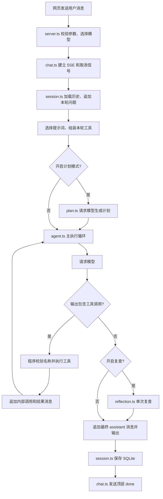
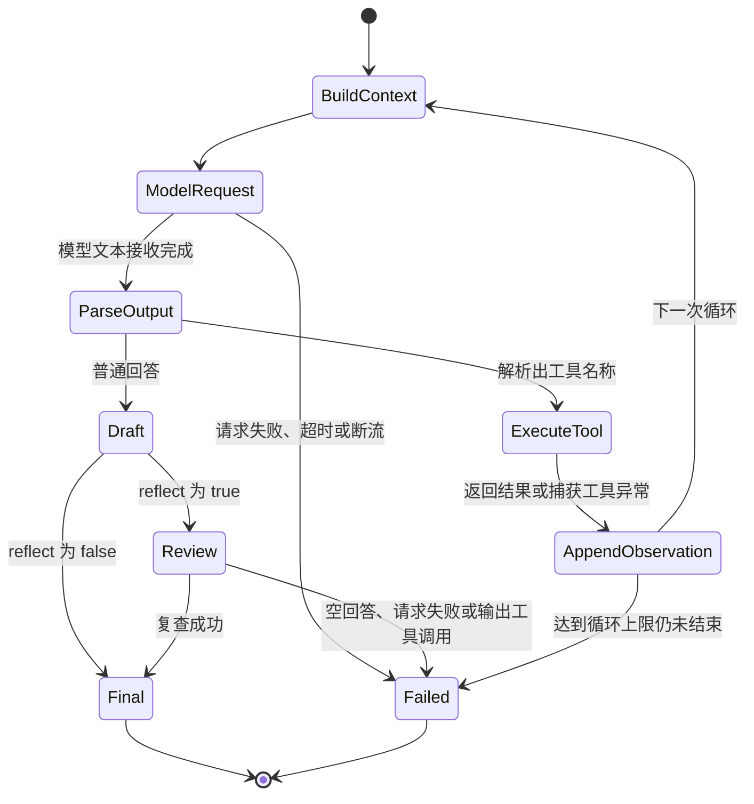
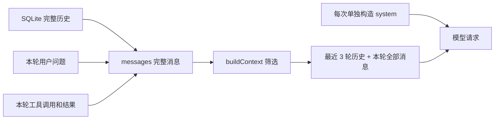
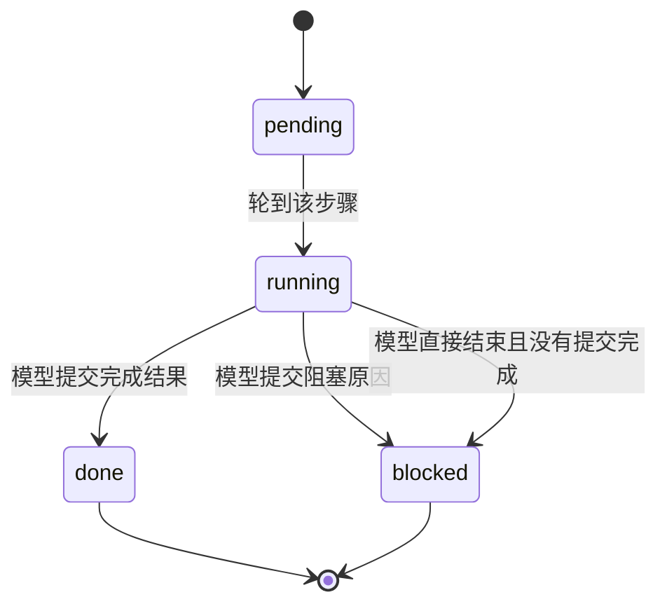
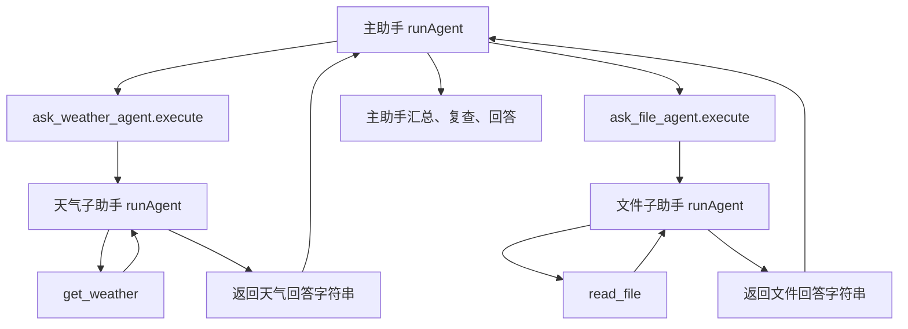

# 当前 Agent 的运行图与状态数据

以 2026-10-22 的本地 Node 实现为准，按代码解释目前学到的工具循环、上下文、Reflection、Plan & Execute、多 Agent 协作。示例中的天气全部是假设的工具返回值，不是实时查询。

建议先看第 1、3、8 节，再对照代码看其他部分。图中的状态名称用于理解控制流程；项目没有定义一个统一的 `AgentState` 类，也没有使用状态图框架。

## 1. 先看整条链路



任一阶段发生不可恢复错误或取消，都可能离开这条正常链路：HTTP 层发送 `error`，本轮不保存。CLI 复用 `runSessionTurn()`，不经过网页 SSE。

这里始终有两个不同动作：

- **模型输出意图**：例如生成 XML，要求查天气。
- **程序实际执行**：解析 XML，在工具注册表中查找并调用函数。

模型生成“成功”几个字，本身不等于数据库、文件或外部服务发生了变化。

## 2. 文件分别负责什么

| 文件 | 职责 |
|---|---|
| `src/server.ts` | 校验 HTTP 请求，调用规则路由，处理连接取消 |
| `src/http/chat.ts` | 将 Agent 事件转为 SSE，发送整轮 `done/error` |
| `src/agent/session.ts` | 加载历史、选提示词、组装工具、成功后保存会话 |
| `src/agent/router.ts` | 每轮选一次模型，手选或按简单规则选择 |
| `src/agent/prompt.ts` | 角色提示词、动态工具说明、自定义 XML 调用协议 |
| `src/agent/context.ts` | 从完整历史中筛选本次模型请求的上下文 |
| `src/agent/agent.ts` | 主循环、工具执行、计划状态推进、调用复查 |
| `src/agent/model-stream.ts` | 请求模型，解析流式返回，处理完成标记和超时 |
| `src/agent/tool-call.ts` | 从模型文本解析工具名称与参数 |
| `src/agent/plan.ts` | 请求规划模型，解析并校验计划 JSON |
| `src/agent/reflection.ts` | 对最终回答初稿执行一次复查 |
| `src/agent/sub-agents.ts` | 将子 Agent 包装成主 Agent 可以调用的工具 |
| `src/tools/index.ts` | 注册实际业务工具 |
| `src/storage/sqlite.ts` | 持久化会话、提示词及相关设置 |
| `admin/app.js` | 根据 SSE 更新回答、等待状态、工具错误和计划进度 |

当前一轮选定的 `model` 会用于规划、主循环、子助手、复查。角色不同不代表模型不同，目前没有按阶段单独配置模型。

## 3. 状态机里的“状态”到底是什么

状态机可以理解为：**当前有哪些数据，执行到哪里，满足什么条件后进入下一步。**

当前实现把这些数据放在不同函数的局部变量中，没有统一塞进一个对象。可以用下面的“概念结构”对照，但它不是代码里真实存在的接口：

```ts
// 阅读辅助，不是新增代码。
const state = {
    model,           // 本轮使用的模型配置
    messages,        // 完整历史 + 本轮新追加消息
    historyEnd,      // 本轮用户问题在 messages 中的起始位置
    context,         // 本次请求选取的消息
    system,          // 本次请求使用的系统消息
    tools,           // 本轮允许执行的工具注册表
    plan,            // 本轮计划，未开启时为空数组
    round,           // 当前主循环请求序号，从 0 开始
    answer,          // 本次模型请求累积的文本，每轮重新置空
    streaming,       // 本次回答是否已经向调用方输出文本
    signal,          // 取消信号
};
```

### 3.1 数据的生命周期

| 数据 | 生命周期 | 保存在哪里 |
|---|---|---|
| 原有会话消息 | 跨轮次 | SQLite |
| 本轮 `messages` | 从加载到本轮结束 | 内存；成功后整体保存 |
| `system` | 当前请求使用，可在下次请求重建 | 内存，不作为会话消息保存 |
| `context` | 每次模型请求重新筛选 | 内存，不额外存一份 |
| `answer` / 复查初稿 | 单次模型响应 | 内存，开启复查时初稿不保存 |
| `plan` | 当前这轮 Agent 调用 | 内存，没有独立计划表 |
| 子助手 `messages` | 每次委派 | 独立内存，不单独保存 |
| 工具调用及结果 | 属于本轮消息 | 主助手内部消息随成功会话保存 |
| SSE 事件 | 实时通知 | 不作为独立执行记录持久化 |

“计划没有独立保存”不等于历史完全没有计划痕迹：`complete_plan_step` 的工具结果包含计划快照，会作为内部消息留下。当前代码不会用这些快照恢复执行指针。

### 3.2 单条消息的真实结构

```ts
type Message = {
    id?: string;
    role: string;
    content: string;
    internal?: boolean;
};
```

本项目使用的典型消息：

```ts
{ role: 'user', content: '北京天气怎么样？' }

{ role: 'assistant', content: '<tool_call ...>...</tool_call>', internal: true }

{ role: 'user', content: '工具 get_weather 的执行结果：{"weather":"晴"}', internal: true }

{ role: 'assistant', content: '根据查询结果，北京天气为晴。' }
```

`internal: true` 是程序自己的标记：前端不展示为普通聊天气泡，上下文筛选时也不把它当作用户新提问。它不代表“模型内部思考”。模型请求发送的是 `role/content`，工具结果目前用 `user` 角色回填，因为使用的是自定义 XML 协议，并非原生 `tool_calls` / `tool` 消息协议。

## 4. 基础工具循环：执行与观察



这是 ReAct 风格的执行—观察循环，不要求模型输出可见的 Thought 字段。日志中的“模型决策”表示程序识别到调用工具或给出回答，不是展示模型内部推理。

### 4.1 一次工具调用前后的数据

初始：

```ts
messages = [
    { role: 'user', content: '查询北京天气' },
];
```

请求模型：

```ts
request.messages = [system, ...context];
```

模型输出：

```xml
<tool_call name="get_weather">
  <params><countyname>北京</countyname></params>
</tool_call>
```

`parseToolCall(answer)` 转成：

```ts
call = { tool: 'get_weather', params: { countyname: '北京' } };
```

程序先追加内部 assistant 调用，再执行：

```ts
result = await tools[call.tool].execute(call.params);
```

执行后：

```ts
messages = [
    { role: 'user', content: '查询北京天气' },
    { role: 'assistant', content: '<tool_call ...>...</tool_call>', internal: true },
    {
        role: 'user',
        content: '工具 get_weather 的执行结果：{"weather":"晴"}',
        internal: true,
    },
];
```

下次请求会把结果带回模型。模型再决定是否调用其他工具，或生成普通回答。**一次工具调用通常需要至少下一次模型请求才能整理成用户答案。**

### 4.2 失败如何进入下一步

工具抛异常时，程序构造：

```ts
result = { error: '具体错误原因' };
```

并追加内部结果消息、发送工具 `error` 事件，随后继续主循环。模型可以修正参数、询问用户或说明无法完成。

当前 `toolError` 来自 `execute()` 抛出的异常。如果某个工具正常返回 `{ error: ... }` 而没有抛异常，调度层仍会把该调用标为工具 `done`；模型可以阅读返回数据中的失败内容。这是现有实现的区别，不要把工具 `done` 直接理解成业务成功。

模型请求失败、无有效回答、超过循环次数等则直接抛出整轮错误，不走工具失败重试分支。

## 5. 上下文：保存的数据与发送的数据不同



进入 `runAgent()` 时，程序找到最后一条 `role === 'user' && !internal` 的消息，以它的位置作为 `historyEnd`。

```ts
const history = messages.slice(0, historyEnd);
const currentTurn = messages.slice(historyEnd);
const context = buildContext(history, currentTurn, { maxHistoryTurns: 3 });
```

例如：

```text
messages = [第1轮, 第2轮, 第3轮, 第4轮, 本轮问题, 本轮工具消息...]
context  = [       第2轮, 第3轮, 第4轮, 本轮问题, 本轮工具消息...]
```

每一“轮”可以包含多条消息。程序按真实用户提问计数，保留配套工具消息，不是简单截取最后三条消息。

当前没有 token 预算、自动摘要、RAG 或跨会话长期记忆。SQLite 保存聊天记录，与主动提取“用户住址”等长期记忆是两件事。

## 6. Reflection：初稿之后再请求一次

```mermaid
sequenceDiagram
    participant Loop as 主循环
    participant Model as 同一个模型
    participant UI as 前端
    Loop->>Model: system + context
    Model-->>Loop: 普通文本初稿 draft
    Loop-->>UI: review running
    Loop->>Model: 复查 system + JSON(context, draft)
    Model-->>Loop: 最终完整答案
    Loop-->>UI: review done
    Loop-->>UI: delta 最终答案
```

复查请求的真实结构可以概括为：

```ts
[
    { role: 'system', content: prompt + '单次复查规则……' },
    { role: 'user', content: JSON.stringify({ context, draft }) },
]
```

复查仅执行一次，不运行工具。空回答、请求失败或返回工具调用都会报错，不自动退回初稿。

原来的 `answer` 依然需要：它保存完整初稿，也用于识别是否是工具调用。开启复查或计划时：

```ts
for await (const text of streamModelResponse(...)) {
    answer += text;
    if (reflect || planExecute) continue;
    // 未开启上述功能时，后面才执行面向用户的流式输出。
}
```

这里的 `continue` 跳过当前文本块后面的显示代码，随后继续接收下一个文本块。它没有结束 `for await`，更没有跳出外层 Agent 循环。

默认 Node 模式 `reflect=true`，最终只展示、保存复查结果。关闭复查且未开启计划时，普通文本可以边接收边显示；XML 或代码围栏开头会先缓冲。子助手关闭复查，包装层收集其文本后才把结果交回主助手。

## 7. Plan & Execute：程序维护计划状态

### 7.1 计划是模型输出的数据

规划模型返回：

```json
{"steps":["查询北京天气","根据天气给出出行建议"]}
```

`createPlan()` 校验 1～6 步，每步非空且不超过 300 字。转换后，`runAgent()` 把第一步设为 `running`：

```ts
plan = [
    { title: '查询北京天气', status: 'running' },
    { title: '根据天气给出出行建议', status: 'pending' },
];
```

规划不会自动运行这些文字，也不会直接执行 CRUD。执行模型每次收到的 system 会包含当前 `JSON.stringify(plan)` 和工具清单。

### 7.2 步骤状态转换



每一步不等于一次模型请求：一个步骤里可以查询工具、修正失败、再提交完成。没有专门的 `currentStepIndex` 变量，程序通过 `findIndex(status === 'running')` 找到当前步骤。

### 7.3 谁推进步骤

开启计划后，程序临时添加控制工具 `complete_plan_step`。模型调用：

```xml
<tool_call name="complete_plan_step">
  <params>
    <status>done</status>
    <result>天气工具返回晴天，已取得查询结果</result>
  </params>
</tool_call>
```

控制工具校验参数，更新**当前**步骤，随后自动激活下一步：

```ts
plan = [
    { title: '查询北京天气', status: 'done', result: '天气工具返回晴天，已取得查询结果' },
    { title: '根据天气给出出行建议', status: 'running' },
];
```

模型不能传一个任意索引跳步。普通业务工具成功也不会自动标记步骤成功，必须提交结果。

若缺少城市等必要信息：

```ts
plan = [
    { title: '确认查询城市', status: 'blocked', result: '用户没有提供城市' },
    { title: '查询天气', status: 'pending' },
];
```

此时 system 不再提供工具，执行层也会拒绝继续调用工具；模型应向用户提问并结束本轮。不是让后端一直挂着等用户回复。

所有步骤完成同样会收起工具，让模型输出汇总。`plan.status=done` 只表示步骤完成，后面仍需要最终回答、复查和保存。

“有充分证据才完成”主要由提示词要求模型判断。程序校验状态转换与参数，不会自动证明每条完成声明属实，也没有额外实现通用业务审批机制。

### 7.4 当前不包含的机制

- 没有 Replanner，没有执行中新增、删除、重排步骤。
- 没有断点恢复；用户补充信息后，再开启的一轮会根据上下文生成新计划。
- 没有独立的工作流数据库表或图执行引擎。
- `snapshot()` 复制步骤对象后再发送事件，避免后续修改把之前发出的计划数据一起改掉。

## 8. 多 Agent：一个工具内部运行另一个循环

### 8.1 主助手与子助手各自拥有什么



工具配置：

| 模式 / 角色 | 工具 |
|---|---|
| 普通主助手 | `get_weather`、`read_file`、`write_file`、`edit_file` |
| 多助手主助手 | `ask_weather_agent`、`ask_file_agent`、`write_file`、`edit_file` |
| 天气子助手 | `get_weather` |
| 文件子助手 | `read_file` |
| 开启计划的主助手 | 在其上述工具基础上增加 `complete_plan_step` |

子助手没有收到其他子助手工具，因此不会继续相互委派。主助手仍能执行写入、编辑，不是所有工具都被移到子助手。

### 8.2 主助手如何传任务

```xml
<tool_call name="ask_weather_agent">
  <params><task>查询北京天气，按工具数据日期回答</task></params>
</tool_call>
```

`agentAsTool()` 校验 `task`，创建一个全新的消息数组：

```ts
const childMessages = [
    { role: 'user', content: '查询北京天气，按工具数据日期回答' },
];
```

主助手历史、主计划、其他子助手结果都不会自动出现在这里。需要共享的信息，必须由主助手写进 `task`。

天气子助手运行后，其内存消息可能变为：

```ts
childMessages = [
    { role: 'user', content: '查询北京天气，按工具数据日期回答' },
    { role: 'assistant', content: '<tool_call name="get_weather">...</tool_call>', internal: true },
    { role: 'user', content: '工具 get_weather 的执行结果：{"weather":"晴"}', internal: true },
    { role: 'assistant', content: '工具返回北京晴天；请按数据日期理解。' },
];
```

包装函数收集子助手 `delta` 文本，返回一个字符串：

```ts
return '工具返回北京晴天；请按数据日期理解。';
```

主助手收到的是普通工具结果，其消息中追加：

```ts
{
    role: 'user',
    content: '工具 ask_weather_agent 的执行结果："工具返回北京晴天；请按数据日期理解。"',
    internal: true,
}
```

外层 `JSON.stringify(result)` 会给字符串加引号，所以此处有双引号。原始天气 JSON 不会自动复制到主助手历史，主助手和最终复查主要依赖子助手的回答。需要更强的证据传递时，可以以后把子助手返回值改成结构化结果；当前学习版尚未实现。

### 8.3 哪些共享，哪些隔离

| 项目 | 当前行为 |
|---|---|
| 模型配置 | 共享同一个 `model` |
| 取消信号 | 共享同一个 `signal` |
| 日志请求 ID | 共用日志函数，子助手消息加角色前缀 |
| 消息历史 | 每次委派独立创建，不自动共享 |
| system | 各自按角色与工具构建 |
| 工具 | 按助手分配，不共享完整注册表 |
| 计划和复查 | 子助手不启用，主助手按配置启用 |
| 前端事件 | 只接收主助手事件，子助手内部事件不逐条转发 |
| 会话保存 | 只保存主助手会话，子助手没有独立会话记录 |

当前是串行委派：主助手 `await` 子助手结果后才能继续。没有并行执行器、自动任务分配表或单独的多 Agent 框架。选择子助手就是主模型选择调用哪个工具。

## 9. 完整演练：计划 + 天气子助手 + 复查

假设开启两个开关，用户问：**“查北京天气，再给我一条出行建议。”** 下面是一条可能的路径，不是模型每次必须输出相同内容。

| 顺序 | 当前动作 | 数据如何变化 | 前端事件 |
|---|---|---|---|
| 1 | HTTP 选模型 | 固定本轮 `model` | `route` |
| 2 | 加载会话 | `messages` 追加真实 user 问题 | — |
| 3 | 规划 | `plan=[]`，等待规划输出 | `plan/planning` |
| 4 | 接收两步计划 | 第一步 running，第二步 pending | `plan/executing` |
| 5 | 主循环第 1 次请求 | 输出 `ask_weather_agent` 调用；追加内部 assistant 消息 | `tool/running` |
| 6 | 天气子助手第 1 次请求 | 独立消息中生成 `get_weather` 调用 | 仅后台子日志 |
| 7 | 天气工具返回 | 子助手追加原始工具结果 | 仅后台子日志 |
| 8 | 天气子助手第 2 次请求 | 生成天气回答，包装层收集并返回 | 仅后台子日志 |
| 9 | 委派完成 | 主助手追加子回答作为内部工具结果 | `tool/done` |
| 10 | 主循环第 2 次请求 | 调用 `complete_plan_step`，完成天气查询；第二步变 running | `tool/running` → `tool/done` → `plan/executing` |
| 11 | 主循环第 3 次请求 | 调用 `complete_plan_step`，结果中记录建议；全部 done | `tool/running` → `tool/done` → `plan/done` |
| 12 | 主循环第 4 次请求 | 无可用工具，输出天气与建议初稿 | — |
| 13 | 单次复查 | 使用上下文与初稿生成最终回答 | `review/running` → `review/done` |
| 14 | 返回最终答案 | 主消息追加最终 assistant | `delta` |
| 15 | 保存会话 | `store.save()` 成功 | 顶层 `done` |

这个示例共调用模型 **8 次**：规划 1 次、主循环 4 次、子助手 2 次、复查 1 次。工具函数执行不是模型请求；提交计划步骤本身不额外请求模型，但“让模型决定提交”发生在一次主循环请求中。

主循环的 `round` 只统计自己的执行请求，不包括规划、子助手和复查。后台看到“第 2 步”可能是第 2 次模型执行请求，不一定是第 2 条计划步骤；子助手也有独立的 `round` 计数。

## 10. 事件、状态、日志不能混为一谈

| 数据或事件 | 谁生成 | 含义 |
|---|---|---|
| `PlanStep.status` | 程序根据模型提交更新 | 某一计划步骤的状态 |
| `plan.status` 事件 | `runAgent()` | 整个计划当前规划、执行、完成或阻塞 |
| `tool.status` 事件 | `runAgent()` | 一次工具调用正在执行、返回或抛错 |
| `review.status` 事件 | `runAgent()` | 复查请求开始或完成 |
| `delta` | `runAgent()` | 要展示的回答文本，不保证一定是逐 token 输出 |
| 顶层 `done` | `chat.ts` | 本轮正常结束且会话保存成功 |
| 顶层 `error` | `chat.ts` | 本轮请求失败或取消 |
| `onStep()` | 运行代码调用 | 后台诊断日志，不是 SSE，也不是模型输出的推理 |

一个容易误会的组合：

```text
plan/blocked → 模型询问“你要查询哪个城市？” → 复查 → delta → 顶层 done
```

这不矛盾：业务计划没完成，但“向用户提问并保存本轮对话”已经正常完成。

网页的“正在整理工具结果”“正在复查答案”等是前端根据事件设置的显示状态，不是模型直接返回的业务字段。日志末尾 `+Nms` 表示同一请求相邻日志间隔，子助手共用该日志函数；它不是整轮累计耗时。

## 11. 超时、取消和保存边界

| 边界 | 当前设置 / 行为 |
|---|---|
| 普通单次模型请求 | 总时限默认 120 秒，无数据默认 45 秒 |
| 规划请求 | 总时限 60 秒，无数据 30 秒，最多输出 1024 tokens |
| 复查请求 | 默认总时限 60 秒，无数据最多 30 秒，最多输出 1024 tokens |
| 主循环 | 普通模式最多 8 次请求，计划模式最多 24 次 |
| 每个子助手 | 自己的普通循环，最多 8 次请求 |
| 网页整轮请求 | 15 分钟总时限 |
| 保存 | 主循环正常返回且未取消后才写 SQLite |

达到循环上限的报错文字目前写“工具调用达到上限”，实际计数对象是执行模型请求，不是单纯工具次数。

停止按钮会取消前端请求，后端连接关闭触发取消信号；主助手和子助手模型请求都会使用该信号。现有普通工具的 `execute(params)` 没有统一接收取消信号，已经开始的文件操作或其他工具不保证立即中断；返回后程序会再次检查取消状态。

当前没有事务性撤销：不保存会话不等于回滚已经写出的文件。复查失败也不会撤销此前工具副作用。

## 12. 对照自己的理解

可以用下面的问题检查是否与代码一致：

1. **Agent 是不是一个 LLM？** 本项目的 Agent 是模型请求、工具、消息状态和控制循环的组合，模型只是其中一部分。
2. **system 就是计划吗？** system 给规划规则；计划是模型返回的数据，再由程序存入 `plan` 并注入后续 system。
3. **LLM 会自动记住上一次请求吗？** 不会。程序必须重新传上下文；子助手也不会自动看到主助手历史。
4. **工具成功就能切下一计划步骤吗？** 当前不会，模型必须调用控制工具提交步骤结果。
5. **调用子助手和调用普通工具有什么区别？** 对主循环都是工具调用，但子助手工具内部会再运行一个完整的 `runAgent()` 循环。
6. **多 Agent 必须多个模型吗？** 不必，本项目共用同一个模型，角色、工具、消息彼此区分。
7. **复查是不是重新做任务？** 当前只检查初稿与已提供结果，不执行工具、不重新规划。
8. **用户确认由程序严格阻止未确认写入了吗？** 当前主要靠提示词约束，没有实现通用审批状态；真实业务要在业务工具里校验权限、参数和确认。
9. **完成本轮就代表完成用户所有目标吗？** 不一定。询问缺失信息、解释工具能力不足，也可以正常结束本轮。
10. **这些模式是否互相替代？** 当前是组合：计划管理外层步骤，工具循环负责执行，多助手把部分执行委派出去，Reflection 检查最终回答。

建议阅读顺序：`session.ts` → `agent.ts` → `tool-call.ts` → `context.ts` → `reflection.ts` → `plan.ts` → `sub-agents.ts`。可以先关掉两个开关，理解一次工具循环，再分别开启，最后同时开启对照第 9 节。
